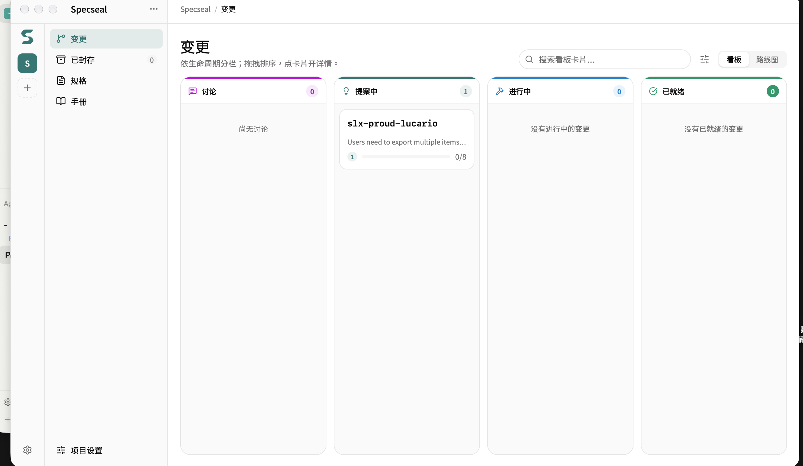
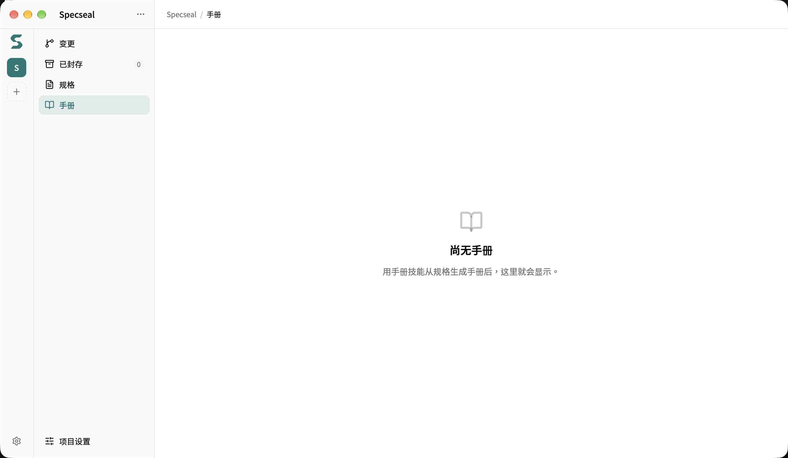
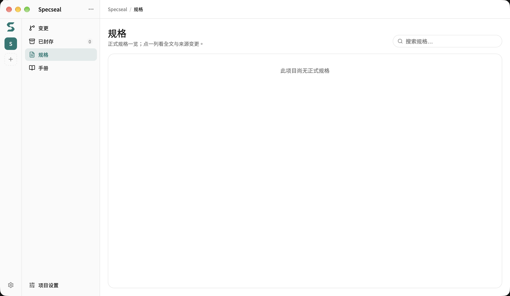
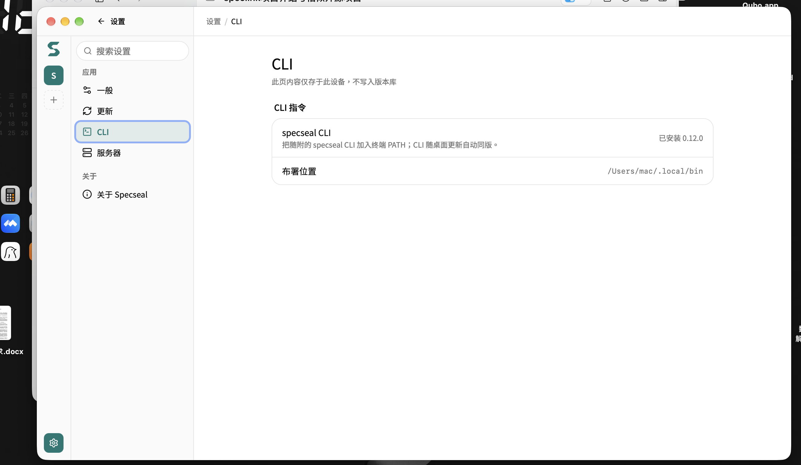

<p align="center">
  <b>Specseal</b>
</p>

<p align="center">
  <b>让 AI 写的每个变更，都盖上对得起规格的验证印章</b>
</p>

<p align="center">
  <a href="https://github.com/MomoChenisMe/speclink/actions/workflows/ci.yml"></a>
  <a href="LICENSE"></a>
</p>

<p align="center">
  <b>简体中文</b> · <a href="README.md">English</a>
</p>

> **关于名字。** Specseal 是 [Specseal](https://github.com/MomoChenisMe/speclink)（MIT）的 fork，重做的内核只有一件事：AI 做的变更，要留下**查得到、机器读得到的验证证据**才算做完。这个版本引擎的指令名还是 `specseal`——改名会和我们自己的发布渠道一起上，不会提前单独改。完整迁移计划见 [REBRAND-NOTES.md](REBRAND-NOTES.md)。

Specseal 是用 Rust 写的 Spec-Driven Development（SDD，规格驱动开发）引擎，让 AI 做的变更可以验收。每个变更先写一小份规格，讲清楚它要做到什幺；接着交给 AI agent 实作；封存前由审查（review）与验证（verify）两道品质关卡检查，verify 会产出一张盖了章、记录范围与轮次的验证票据。规格是 repo 里的纯文本。

添加的文档：[项目原则（principles）](docs/principles.md)、[与主流项目的诚实对比](docs/comparison.md)、[让 AI 帮你安装的 setup prompt](docs/ai-setup-prompt.md)、[通用 agent 指令档](integrations/universal/SPECSEAL-AGENT-INSTRUCTIONS.md)、[CI 验证关卡范本](integrations/ci/specseal-verify.yml)。

Specseal 有两条部署路径：一个人用 Local Repo 就够；团队要共用规格再接 Remote Store。

- **Local Repo**：规格放在 repo 的 `specseal/`，用 Git 协作，不需要 server。
- **Remote Store**：规格放在团队共用的 Store，由 Host 统一处理认证、版本、交易、事件与流程判定。Host 与 Protocol 都是公开契约，server 可以用官方那一份，也可以自己写。PM、PO 在团队这一层参与讨论与提案，和 RD、AI Agent 用同一套语意协作：change（变更）、artifact（产物）、task（任务）、verify（验证）与 archive（封存）。



## <a id="why"></a>为什幺用 Specseal

- **规格就放在代码旁边。** 规格是 repo 里的 Markdown 与 YAML 纯文本档。不装 Specseal 也读得懂，每次修改都看得到 Git diff。
- **AI Agent 知道每一步该做什幺。** Specseal 为 Claude Code、Codex、GitHub Copilot、pi 与 Cursor 产生技能。每个技能告诉 Agent 要读什幺、要写什幺、什幺时候停下来问你。
- **封存前先检查。** 封存前有两道选用的品质关卡：`review` 看代码写得好不好，`verify` 看交付是否符合规格。
- **一个人到整个团队，同一套流程。** 先在自己的 repo 用 Git 开始。团队变大后再接上共用的 server，流程与用语都不变。

## <a id="quick-start"></a>快速开始

1. 安装 CLI：

   ```bash
   npm i -g @specseal/cli
   ```

   Homebrew、安装脚本与桌面 app 见[安装](#install)。

2. 在要导入 Specseal 的 repo 里初始化：

   ```bash
   specseal init --tools claude,codex
   ```

   `--tools` 列出你用的 Agent 工具：`claude`、`codex`、`copilot`、`pi`、`cursor`，用逗号任意组合。

3. 请 Agent 开一个变更：在 Claude Code、GitHub Copilot 或 Cursor 输入 `/specseal-propose <变更名称>`，在 Codex 输入 `$specseal-propose <变更名称>`，在 pi 输入 `/skill:specseal-propose <变更名称>`。Agent 会写出提案、规格与任务清单。

完整的第一轮（提案、实作、检查、封存）见 [Local Repo 入门](docs/getting-started.zh-CN.md)。要接共用的 server，见 [Remote 入门](docs/remote-getting-started.zh-CN.md)。

## <a id="screenshots"></a>画面一览

<table>
  <tr>
    <td width="50%"><br /><sub>变更看板：依生命周期分栏，点卡片开详情</sub></td>
    <td width="50%"><br /><sub>由正式规格产生的手册</sub></td>
  </tr>
  <tr>
    <td width="50%"><br /><sub>一份正式规格的需求与情境</sub></td>
    <td width="50%"><br /><sub>CLI 状态与部署位置</sub></td>
  </tr>
</table>

> 其余画面（变更详情、托盘面板、Claude Code 插件、Herdr 面板、server 后台）的截图将在对应界面于简中环境下重新截取后补充。

## <a id="features"></a>特色

- **纯文本**：Local 模式的产物放在 repo 的 `specseal/` 底下：`specs/<capability>/spec.md`、`changes/<名称>/`、`changes/archive/` 与 `config.yaml`。内容全是 Markdown 与 YAML，不装 Specseal 也读得懂、改得动，每次变动都看得到 Git diff。Specseal 只多放两样东西：`discussions/`（讨论记录）与每个变更的 `.meta.yaml`（生命周期数据）。这一点只适用 Local 模式；远程模式的正式规格在 Store，本机只有唯读投影。已经在用 OpenSpec 的项目，在项目根运行 `specseal init` 就能导入：`openspec/` 会搬到 `specseal/`，之后 OpenSpec CLI 就读不到这个项目，所以这是单向的导入，不能再转回去。
- **给 AI Agent 的技能**：`specseal init` 为 Claude Code、Codex、GitHub Copilot、pi 与 Cursor 产生技能档。从讨论、提案、实作、品质关卡到封存，每一站都有对应的 `/specseal-*` 指令（Codex 写成 `$specseal-*`，pi 写成 `/skill:specseal-*`）。
- **桌面看板**：每个变更是一张卡片。你看得到它在哪一站、任务做到哪里、规格改了什幺。
- **品质关卡**：`review` 看代码写得好不好，`verify` 看交付是否符合规格。两道都是选用的。
- **运行顺序**：`specseal plan` 依声明的依赖把变更分成一波一波，并指出下一个可以开工的变更。
- **手册与溯源**：Specseal 能从正式规格产生好读的手册，`trace` 指令列出一项能力是怎幺一步步形成的。
- **团队共用**：接上 server 之后，CLI、桌面 app 与 Agent 读写同一份正式规格。

## <a id="workflow"></a>工作流程

```text
baseline? → discuss?/improve? → propose → apply ⇄ ingest → (quality? | review? ∥ verify?) → archive
                                            ↑
                                    闲置后续作：先 drift

worktree：apply-with-worktree ⇄ ingest → (quality? | review? ∥ verify?) → worktree-merge → archive

工具：validate / analyze / audit / commit / config / manual / trace / plan
```

带 `?` 的站是选用的。从哪一站开始，看你手上的情况：

| 情况 | 入口 |
| --- | --- |
| 需求已经清楚 | `propose` |
| 需求还要收敛 | `discuss`（你带题目）或 `improve`（请模型帮你找题目） |
| 既有进程还没有规格 | `baseline` |
| 实作途中需求改变 | `ingest` |
| 变更闲置一阵子才继续 | 先 `drift` |
| 想同时推多个互不冲突的变更 | worktree 流程 |

封存前有两道选用的品质关卡：`review` 看工艺，`verify` 看是否符合规格。依风险决定要跑哪几道；低风险的变更两道都跳过也可以。

每一站的用途、技能、完成判准与下一站见[完整 SDD 工作流](docs/workflow.zh-CN.md)。

## <a id="install"></a>安装

桌面 app 与 CLI 是同一套引擎的两种用法，择一即可：

- 想看看板、规格与讨论：装桌面 app。安装档内含同版 CLI。
- 不需要图形接口，或要用在脚本与 CI：只装 CLI。功能一样完整。

### 桌面 app

到 [Releases](https://github.com/MomoChenisMe/speclink/releases/latest) 下载你的平台的安装档：

| 平台 | 安装档 |
| --- | --- |
| macOS | `Specseal_<版本>_universal.dmg`（Apple Silicon 与 Intel 同一档） |
| Windows | `Specseal_<版本>_x64-setup.exe` |
| Linux 桌面 | `Specseal_<版本>_amd64.AppImage`（x86_64）或 `Specseal_<版本>_aarch64.AppImage`（arm64），免安装 |

- Windows 安装档没有代码签章。第一次运行时 SmartScreen 会跳出警告，点「其他信息」→「仍要运行」。
- 没有图形接口的 Linux（服务器、WSL、CI）不装桌面 app，改用下面的 CLI。

### CLI

三种方式装到的是同一份运行档（来源是 npm 上的 `@specseal/cli`），择一即可：

```bash
# 有 Node.js（任何平台）
npm i -g @specseal/cli

# 没有 Node.js 的 macOS／Linux（服务器、WSL、CI）
curl -fsSL https://raw.githubusercontent.com/MomoChenisMe/speclink/main/scripts/install.sh | sh

# Homebrew（macOS／Linux）
brew install MomoChenisMe/tap/specseal
```

Windows 没有安装脚本：有 Node.js 就用 npm，没有就装桌面 app（安装器会一并设好 CLI 的 PATH）。

CLI 与桌面 app 都想装？桌面 app 可能换掉你的 CLI，先看 [Local Repo 入门的安装一节](docs/getting-started.zh-CN.md#install)。那一节也列出安装脚本的选项，以及旧版 Linux 套件换成 AppImage 的方式。

### Claude Code 插件（选用）

`specseal-skills` 在 Claude Code 的输入框上方加一排可以点的 specseal 技能按钮，另有一个侧边面板列出变更、讨论与未结的品质工单。在 Claude Code 里输入：

```text
/plugin install specseal-skills --marketplace MomoChenisMe/speclink
```

需求、设置与已知限制见 [specseal-skills](integrations/claude-code/specseal-skills/README.md)。

> 插件界面的截图将在简中环境下重新截取后补充。

### Herdr mod（选用）

`specseal` 在 [Herdr](https://herdr.dev) 的终端机旁边加一个面板，列出目前项目的变更与讨论，并显示 review 和 verify 的章。它会建议下一步，把技能交给对的 agent，也可以开新的 agent。左边侧栏会显示每个项目在各阶段有几个变更，并依 space 整理 agent。接口文本跟随系统语言，Herdr 内置的设置页和菜单也一样。

让 Herdr 开着，在这个 repo 的 clone 里运行：

```bash
cp -R integrations/herdr/mods/specseal integrations/herdr/mods/specseal-new ~/.config/herdr-app/mods/
node scripts/herdr/dock-panel.mjs
```

> Herdr 面板与技能跳窗的截图将在简中环境下重新截取后补充。

快捷键、需求与已知限制见 [Specseal 的 Herdr mod](integrations/herdr/README.md)。

## <a id="self-hosting"></a>自架 server

Server 只有在团队要共用同一份正式规格时才需要。一个人在自己的 repo 里用，不必装 server。

`specseal-server` 是官方的**参考实作**，让你开箱即用，或拿来试远程功能。三种跑法择一：

| 跑法 | 指令 |
| --- | --- |
| npx（有 Node.js 就能跑） | `npx @specseal/server` |
| Docker | `docker run -d -p 8080:8080 -v specseal-data:/data ghcr.io/momochenisme/speclink-server:latest` |
| Docker Compose | `cd deploy && docker compose up -d` |

第一次启动时，server 会印出一次性的 `/setup` 链接；之后重启不会再印。缺省用 SQLite，数据放在 `./specseal-data`（容器内是 `/data`）。环境变量、PostgreSQL 与升级回退见 [Server 部署](docs/server-deployment.zh-CN.md)。桌面 app 与 CLI 怎幺连上，见 [Remote 入门](docs/remote-getting-started.zh-CN.md)。

远程模式不绑这一份 server。远程模式由两份公开契约定义：`specseal/specs/` 底下的 `host-runtime` 与 `client-protocol`。你可以用 Specseal 引擎自己写 server，接上自家的认证、数据库与权限模型，CLI 与桌面 app 一样接得上。加载引擎的方式见 [Node SDK](docs/sdk-node.zh-CN.md)。

## <a id="docs"></a>文档

**一个人用，先读这三份**

| 文档 | 内容 |
| --- | --- |
| [Local Repo 入门](docs/getting-started.zh-CN.md) | 从安装到第一次封存 |
| [完整 SDD 工作流](docs/workflow.zh-CN.md) | 每一站的用途、技能、完成判准与下一站 |
| [设置说明](docs/configuration.zh-CN.md) | `.specseal.yaml`、`specseal/config.yaml` 与远程设置 |

**团队共用一份正式规格**

| 文档 | 内容 |
| --- | --- |
| [Remote 入门](docs/remote-getting-started.zh-CN.md) | 从启动 server 到 Desktop 与 CLI 连上 |
| [Server 部署](docs/server-deployment.zh-CN.md) | npx、Docker、Compose、升级与回退 |
| [Server 保存后端](docs/server-store-drivers.zh-CN.md) | SQLite、Server FS、PostgreSQL 怎幺选 |
| [Server 备份与还原](docs/server-backup.zh-CN.md) | `backup`、`verify-backup`、`restore` |

**把 Specseal 接进自己的进程**

| 文档 | 内容 |
| --- | --- |
| [Node SDK](docs/sdk-node.zh-CN.md) | `@specseal/engine` 的加载、Store 接口与 `dispatch` |
| [动词与旗标契约](docs/verb-contract.zh-CN.md) | 动词在本地与远程的归属、输出格式与 HTTP 端点 |

**项目现况与方向**

| 文档 | 内容 |
| --- | --- |
| [项目能力状态](docs/product-status.zh-CN.md) | 哪些能用、哪些部分可用，附证据与限制 |
| [项目路线图](docs/roadmap.zh-CN.md) | 之后要做的方向 |
| [更新日志](CHANGELOG.zh-CN.md) | 每个版本改了什幺 |
| [品牌资产](docs/assets/brand/README.md) | Logo、配色与使用方式 |

`specseal/` 是 Specseal 自己的规格。`specseal/changes/archive/` 与 `specseal/discussions/archive/` 是历史记录，不是操作文档。

## <a id="status"></a>目前状态

- **可用**：Local Repo CLI、Local 桌面 app、Agent 技能（Claude、Codex、GitHub Copilot、pi 与 Cursor）、品质关卡、运行顺序、手册与溯源、Node SDK（`@specseal/engine`）、三种 TeamStore（SQLite、Server FS、PostgreSQL）、单节点 server 与后台、Remote CLI、安装通路、server 营运（部署、备份还原）。
- **部分可用**：桌面 app 的远程项目、Claude Code 插件、Herdr mod。
- **规划中**：Agent 工具套件与 MCP、SSO、runtime plugin、多节点部署。

每一项的证据、限制与查核日期见[项目能力状态](docs/product-status.zh-CN.md)。还没做的方向见[项目路线图](docs/roadmap.zh-CN.md)。

## <a id="contributing"></a>参与贡献

欢迎用英文或简体中文开 issue 与送 pull request。

- 开发环境、要跑的测试、commit 写法，以及变更如何走 Specseal 自己的流程，见 [CONTRIBUTING.md](CONTRIBUTING.md)（英文）。
- 安全性问题不要开公开 issue，依 [SECURITY.md](SECURITY.md)（英文）私下回报。
- 一键开发环境（`npm run dev` 等五个入口）、完整的测试指令与 repo 结构，见[开发环境](docs/development.zh-CN.md)。

从原代码建置 CLI（需要 stable Rust toolchain）：

```bash
cargo install --path crates/adapters/specseal-cli
specseal --version
```

## <a id="acknowledgments"></a>致谢

- [Spectra App 2.3.1](https://github.com/kaochenlong/spectra-app)：Local CLI 设计之初以它附的 CLI 为行为参考。golden 与 CLI 集成测试守住人眼输出、`--json` 格式与内核工作流。Specseal 在这个基础上加入讨论、桌面 app、Store 抽象层、Node SDK 与远程平台。
- [OpenSpec](https://github.com/Fission-AI/OpenSpec)：Local 模式的规格与变更沿用 OpenSpec 的目录结构。

## <a id="license"></a>授权

[MIT](LICENSE)
