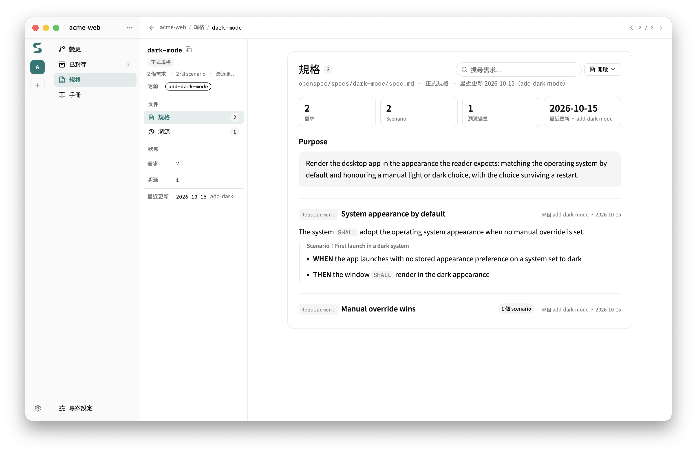

# Local Repo 入门

**简体中文** · [English](getting-started.md)

照这份文档走完第一轮：**安装 → 初始化 → 提案 → 实作 → 检查 → 封存**。规格放在你的 repo 里，用 Git 协作，不需要 server。

每一步都附上预期输出。看到的不一样，就先停下来找差在哪里。这里只走主路径；其他分支见[完整 SDD 工作流](workflow.zh-CN.md)。

## <a id="before"></a>开始前

范例需求是「添加 CSV 导出」，而且需求已经清楚。如果你还在比较做法、需要做决定，先跑 `discuss`（见[工作流](workflow.zh-CN.md#discuss)）。

你可以用六种方式操作，效果相同：

| 方式 | 写法 | 说明 |
| --- | --- | --- |
| Claude Code | `/specseal-propose add-csv-export` | 斜线指令 |
| Codex | `$specseal-propose add-csv-export` | `$` 加技能名；也可以输入 `/skills` 从清单挑 |
| GitHub Copilot | `/specseal-propose add-csv-export` | 斜线指令，写法和 Claude Code 相同 |
| pi | `/skill:specseal-propose add-csv-export` | `/skill:` 加技能名 |
| Cursor | `/specseal-propose add-csv-export` | 斜线指令，写法和 Claude Code 相同 |
| 直接用 CLI | `specseal new change add-csv-export` | 不经 Agent，自己写每份文档 |

技能（skill）是写给 Agent 读的流程说明：什幺时候读什幺、怎幺产生文档、什幺时候停下来。真正运行动作的是 `specseal` CLI。一般用户用技能就好。`/specseal-analyze` 只有 Claude Code 有；Codex、GitHub Copilot、pi 与 Cursor 直接用 CLI 的 `specseal analyze`。

## <a id="install"></a>1. 安装

装 CLI，三种择一：

```bash
# 有 Node.js（任何平台）
npm i -g @specseal/cli

# 没有 Node.js 的 macOS／Linux（服务器、WSL、CI）
curl -fsSL https://raw.githubusercontent.com/MomoChenisMe/speclink/main/scripts/install.sh | sh

# Homebrew（macOS／Linux）
brew install MomoChenisMe/tap/specseal
```

想要图形接口，到 [Releases](https://github.com/MomoChenisMe/speclink/releases/latest) 下载桌面安装档（macOS universal dmg、Windows 安装器、Linux AppImage），里面已含同版 CLI。Windows 没有安装脚本：用 npm，或装桌面 app。

已经装过 CLI 又要装桌面 app，先看下面的[同时装 CLI 与桌面 app](#cli-and-desktop)，桌面 app 可能换掉你的 CLI。

确认安装成功：

```bash
specseal --version
```

**预期输出**：一行版本字符串，例如 `specseal 0.8.0 (arm64, engine v1.48.0)`。

### <a id="install-script"></a>安装脚本的选项

安装脚本会侦测平台、核对 npm 套件的 sha512，再把 `specseal` 放进 `~/.local/bin`。可用三个环境变量调整：

| 变量 | 用途 |
| --- | --- |
| `SPECSEAL_INSTALL_DIR` | 改安装位置 |
| `SPECSEAL_INSTALL_VERSION` | 钉选版本（`0.5.0` 或 `v0.5.0` 都可以；0.5.0 之前的版本不在 npm 上） |
| `SPECSEAL_INSTALL_REGISTRY` | 换 npm registry |

### <a id="cli-and-desktop"></a>同时装 CLI 与桌面 app

桌面 app 和安装脚本都用 `~/.local/bin/specseal` 这个位置，所以桌面 app 可能换掉你的 CLI：

| 平台 | 桌面 app 对 `~/.local/bin/specseal` 做的事 |
| --- | --- |
| macOS | 每次启动都检查一次；没装或版本和 app 不同时，删掉原档，换成指向内置 CLI 的 symlink |
| Linux AppImage | 只在版本不符时覆盖 |
| Windows | 不动这个位置；PATH 由安装器管理 |

所以 `SPECSEAL_INSTALL_VERSION` 钉选的版本也会跟着失效：只要版本和 app 不同，就会被换掉。要保留自己那份 CLI，安装时用 `SPECSEAL_INSTALL_DIR` 指到别的目录，再把那个目录排在 PATH 中 `~/.local/bin` 的前面。

### <a id="from-deb"></a>从 .deb 换成 AppImage

0.5.0 起不再提供 `.deb`。用 `.deb` 装过的人，先运行 `sudo apt remove specseal`，再改用 AppImage。

## <a id="init"></a>2. 初始化

切到你的 repo，运行：

```bash
specseal init --tools claude,codex
```

**预期输出**：

```text
✓ Initialized at /path/to/your-repo/specseal
Generated files for: claude, codex
```

`--tools` 选要产生技能的 Agent 工具：`claude`、`codex`、`copilot`、`pi`、`cursor`，用逗号任意组合。只用 GitHub Copilot 就写 `--tools copilot`。

这一步会：

- 创建 `specseal/` 与 `.specseal.yaml`。
- 产生所选工具的技能档：Claude 在 `.claude/skills/`，Codex 在 `.agents/skills/`，GitHub Copilot 在 `.github/skills/`，pi 在 `.pi/skills/`，Cursor 在 `.cursor/skills/`。
- 把 `.specseal/`（本机工作数据）加进 `.gitignore`。

它不会改你的 `CLAUDE.md`、`AGENTS.md` 或 `.github/copilot-instructions.md`，也不会创建 `.cursor/rules/`。Agent 靠技能档自己的说明判断什幺时候用哪个技能。用 pi 时要先信任这个项目，pi 才会读项目里的技能。同时选了 `codex` 与 `pi` 时，pi 启动会对每个同名技能显示一则警告；pi 用的是 `.pi/skills/` 的 pi 版，功能不受影响。

`specseal/` 的目录结构：

```text
specseal/
├── config.yaml                  工作流设置
├── specs/<capability>/spec.md   正式规格，一个 capability 一份
├── changes/<名称>/               进行中的变更
├── changes/archive/             已封存的变更
└── discussions/                 讨论记录（Specseal 添加）
```

全部是纯 Markdown 与 YAML。不装 Specseal 也读得懂、改得动，每次变动都看得到 Git diff。Specseal 只多两样东西：`discussions/`，以及每个变更目录里的 `.meta.yaml`（记录开工时间、来源讨论等生命周期数据）。

这一点只适用 Local 模式。接上远程 server 之后，正式规格在 Store 里，本机只有唯读的投影（`.specseal/context/`）。

确认起点是空的：

```bash
specseal list
specseal validate --specs --all --strict
```

**预期输出**：`list` 印出 `No active changes.`。`validate` 在还没有任何正式规格时不印任何东西，并以 0 结束。没有输出就是通过。

如果 repo 已经有很多代码却没有规格，先跑 `/specseal-baseline`（Codex 为 `$specseal-baseline`，pi 为 `/skill:specseal-baseline`），依现在的行为创建规格，再开新变更。

## <a id="propose"></a>3. 提案

请 Agent 创建变更。在 Claude Code、GitHub Copilot 或 Cursor：

```text
/specseal-propose add-csv-export
```

在 Codex：

```text
$specseal-propose add-csv-export
```

在 pi：

```text
/skill:specseal-propose add-csv-export
```

Agent 会创建变更，并写出开工前需要的文档：

- `proposal.md`：为什幺做、做什幺。
- delta 规格：这次要添加或修改的规格。
- `tasks.md`：任务清单。

`design.md`（技术设计）是选用的，只有跨模块或有重要技术决定时才写。所以不是每个变更都有四份文档。

随时可以查进度：

```bash
specseal status --change add-csv-export
```

**预期输出**（文档写完之后）：

```text
Change: add-csv-export
Schema: spec-driven

  ✓ proposal (proposal.md)
  ○ design (design.md)
  ✓ specs (specs/**/*.md)
  ✓ tasks (tasks.md)
```

`✓` 是已完成，`○` 是可以写但还没写，`✗` 是还在等前一份文档。`design` 停在 `○` 是正常的：开工只需要 `tasks` 完成。

提案完成后，Agent 会自己跑 `analyze` 与 `validate` 检查文档。

如果需求来自一份已写结论的讨论，改用 `/specseal-propose --from-discussion <slug>`。其他讨论结论的走法见[讨论结论怎幺走](workflow.zh-CN.md#discussion-outcomes)。

<details>
<summary>不经 Agent，直接用 CLI 写文档</summary>

适合已经熟悉文档格式的人。流程是：创建变更 → 读某份文档的写作说明 → 从 stdin 写入。

```bash
specseal new change add-csv-export
specseal instructions proposal --change add-csv-export
specseal new artifact proposal --change add-csv-export --stdin < proposal.md
specseal new artifact spec csv-export --change add-csv-export --new --stdin < spec.md
specseal new artifact tasks --change add-csv-export --stdin < tasks.md
```

- `instructions` 印出这份文档该写哪些段落与范本。
- 新的 capability 要加 `--new`，而且 delta 规格要以 `## Purpose` 段落开头（一两句、50 字符以上）。
- `new change` 的预期输出：

```text
✓ Created change: add-csv-export
  Path: /path/to/your-repo/specseal/changes/add-csv-export
  Schema: spec-driven
```

</details>

## <a id="apply"></a>4. 实作

文档完成后，请 Agent 开始实作。在 Claude Code、GitHub Copilot 或 Cursor：

```text
/specseal-apply add-csv-export
```

在 Codex：

```text
$specseal-apply add-csv-export
```

在 pi：

```text
/skill:specseal-apply add-csv-export
```

Agent 会先跑 `specseal plan` 确认这个变更没有被其他变更挡住，再读提案、规格、设计（如果有）与任务，一项一项实作。每完成一项，它用 `specseal task done` 勾掉：

```text
✓ Task 1 marked as done: 1.1 Serialize report rows to CSV
```

只有这一项的行为与该过的测试都通过了，才可以勾。勾错了用 `specseal task undone --change add-csv-export <编号>` 取消。不要直接改 `tasks.md` 的勾选。

标着 `[M]` 的任务是手动任务，要由你自己确认，Agent 不会代勾。

全部勾完后，`specseal list` 显示进度已满：

```text
Changes:
  • add-csv-export [2/2] — Reports can only be read insid…
```

## <a id="check"></a>5. 检查

**多数时候你不必自己跑这一步。** `propose`、`ingest` 与 `apply` 技能都会自动跑 `analyze`。想自己看一眼、或要在 CI 里把关时，运行：

```bash
specseal analyze add-csv-export
specseal validate add-csv-export
```

- `analyze` 交叉比对提案、规格、设计与任务，从四个面向找问题：涵盖（Coverage）、一致（Consistency）、模糊（Ambiguity）、缺漏（Gaps）。
- `validate` 检查文档的格式与必要段落。

**预期输出**：

```text
Change: add-csv-export

  ● Coverage       1 issue(s) found (1 findings)
  ✓ Consistency    Skipped (insufficient artifacts) (0 findings)
  ✓ Ambiguity      Clean (0 findings)
  ✓ Gaps           Clean (0 findings)
  ...
  [WARNING] Requirement 'Export report as CSV' has no matching task

✓ add-csv-export — valid
```

这个 WARNING 的意思是：规格写了一条要求，任务清单里没有明确对应的项目。Consistency 显示 `Skipped` 是因为没有 `design.md`。

- CRITICAL：先修文档再实作。
- WARNING 与 SUGGESTION：不挡你，但要看过再决定。

`analyze` 与 `validate` 只检查文档，**不能取代进程测试**。项目自己的测试、lint 与 build 照常要跑。

代码的把关有两道选用的品质关卡：`/specseal-review` 看代码写得好不好，`/specseal-verify` 看交付是否符合规格，两道都要跑就用 `/specseal-quality`。第一轮的小变更跳过也可以。规则见[工作流](workflow.zh-CN.md#quality)。

## <a id="archive"></a>6. 封存

任务全部完成、文档检查通过、选择要跑的品质关卡也结束之后，请 Agent 封存。在 Claude Code、GitHub Copilot 或 Cursor：

```text
/specseal-archive add-csv-export
```

在 Codex：

```text
$specseal-archive add-csv-export
```

在 pi：

```text
/skill:specseal-archive add-csv-export
```

或直接运行：

```bash
specseal archive add-csv-export -y
```

**预期输出**：

```text
✓ Archived: add-csv-export → <日期>-add-csv-export
Specs applied: csv-export (added: 1, modified: 0, removed: 0, renamed: 0)
Snapshot created for unarchive support.
```

封存会把 delta 规格合并进正式规格，并把变更移到 `specseal/changes/archive/`。之后 `specseal list` 回到 `No active changes.`，`specseal/specs/csv-export/` 出现。这就是这一轮的成果。

在桌面 app 的「规格」页可以看到合并后的正式规格，每项能力一列；点一列打开它的详情页，看得到需求与情境。



不要用 `--mark-tasks-complete` 或 `--no-validate` 跳过没做完的工作。

## <a id="created"></a>产物在哪里

| 路径 | 内容 |
| --- | --- |
| `specseal/specs/<capability>/spec.md` | 正式规格：系统现在的行为 |
| `specseal/changes/<名称>/` | 进行中的变更与它的文档 |
| `specseal/changes/archive/` | 已封存的变更 |
| `specseal/discussions/` | 讨论记录（需要做决定时才有） |
| `specseal/config.yaml` | 工作流设置：语言、项目说明、产出规则、TDD、audit、worktree |
| `.specseal.yaml` | 这个 checkout 的工具与远程绑定 |
| `.specseal/` | 本机工作数据（不进 Git） |

设置的细节见[设置说明](configuration.zh-CN.md)。

## <a id="upgrade"></a>旧项目升级与 OpenSpec 导入

**旧版 Specseal 创建的项目**把规格放在 `openspec/`。升级 Specseal 之后，在项目根运行：

```bash
specseal update
```

`update` 会把 `openspec/` 搬到 `specseal/`，再把每个变更（进行中与已封存）的 `.openspec.yaml` 改名为 `.meta.yaml`，文档内容不变。它不会帮你 commit：搬完请自己 commit，`specseal/` 是添加、`openspec/` 是删除。团队成员要先升级 Specseal 再 pull 这个 commit，旧版看不到新的文档夹，会以为项目是空的。你自己的脚本、CI 设置与 `.gitignore` 里写到 `openspec/` 的地方，也要自己改。

遇到下面两种情况，`update` 会暂缓搬移并说明原因，技能档照常更新：

- 还有其他 worktree：每个 worktree 都有自己的一份 `openspec/`。先合并或移除它们再运行。在 linked worktree 里运行时，请回主目录运行。
- `openspec/` 有未提交的修改（包含还没追踪的新档）：先 commit 再运行。

不搬也能照常使用：Specseal 会继续读 `openspec/`，每次运行时在 stderr 印一行提醒。`.specseal.yaml` 写明 `spec_dir` 的项目不会自动搬移。

**OpenSpec 项目**：在项目根运行 `specseal init`（加上需要的 `--tools`）。Specseal 会把 `openspec/` 搬到 `specseal/`，保留原本的 `config.yaml`、`schemas/`、正式规格与变更，再补上 `.specseal.yaml`、`.gitignore` 设置与技能档。有其他 worktree 或 `openspec/` 有未提交的修改时，`init` 会拒绝，不写任何文档。导入是单向的：之后 OpenSpec CLI 读不到这个项目。OpenSpec 自己装的技能与指令档不会被搬动或删除，不再使用的话请自己删。

## <a id="next"></a>接下来

- 需求还要收敛：`/specseal-discuss`；讲不出要改哪里：`/specseal-improve`。
- 实作途中需求改变：`/specseal-ingest`。
- 变更停了一阵子才继续：先跑 `/specseal-drift <变更名称>`。
- 想同时推多个互不冲突的变更：worktree 流程，见[工作流](workflow.zh-CN.md#worktree)。
- 想知道哪个变更先做：`specseal plan`。
- 要和团队共用规格：见 [Remote 入门](remote-getting-started.zh-CN.md)。
- 想知道某项能力现在能不能用：见[项目能力状态](product-status.zh-CN.md)。
