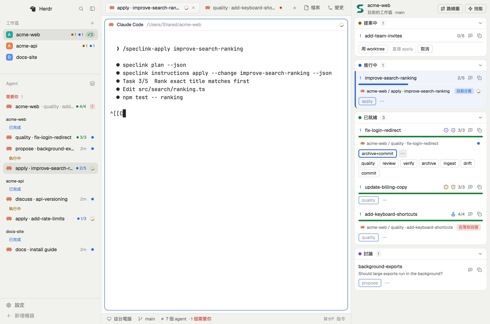
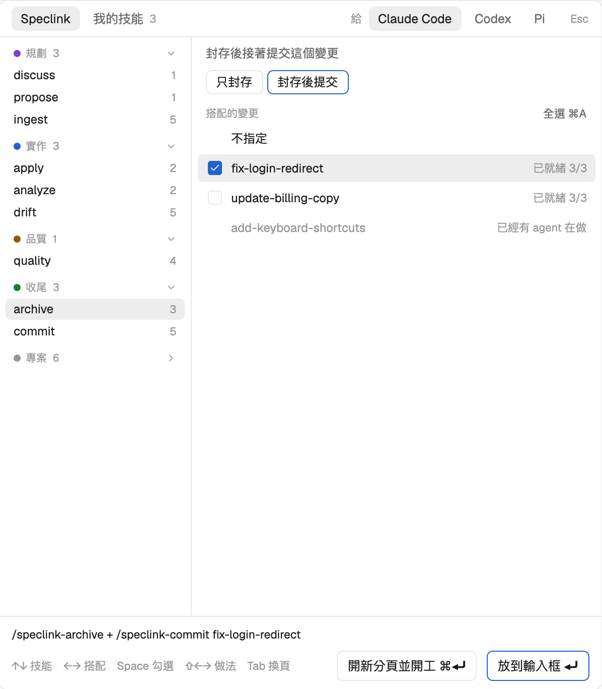

# specseal：Specseal 的 Herdr mod

[English](README.en.md)

在 [Herdr](https://herdr.dev) 里开一个面板，看目前项目的变更与讨论，按一下就把技能交给对的 agent、开工，或叫 Specseal 开详情。全程不用手打变更名称、不用找窗口。



## 一个变更怎幺走

面板依阶段和章建议下一步，所以大多时候只要按列上那一颗钮：

1. **提案中**：按「开工」，新 agent 开在目前的工作区。有开 worktree 流程时，会先问要用 worktree 还是直接 apply。
2. **进行中**：列上看得到 agent 和任务进度。只剩手动任务时，有 worktree 的建议 `worktree-merge`，没有的建议 `quality`。
3. **进程任务做完，有 worktree**：按 `worktree-merge` 合并回主分支。没有 worktree 就跳过这一步。
4. **已就绪**：按 `quality`。跑的时候名称旁边是蓝色图标，两站都盖章后变成紫色。
5. **两站都盖章**：按 `archive+commit` 封存并提交。

要跑别的技能时按 `⋯`。

## 面板有什幺

面板有两种放法。两种都不抢键盘，项目都跟着目前焦点所在的终端机走，切 space 就换项目。

- **停靠**：使用 `specseal` 版面（见「安装」），面板在窗口最右侧。首次进入工作区时默认收起；右上角 12px 的 Specseal 小图标或 `⌘⇧S` 可展开/收起。每个工作区分别记住手动开关状态。工作区标题右侧的「＋」提供「新建工作区」和「添加项目…」，后者先选择本地文件夹，再在其中打开终端。
- **弹出**：其他版面按 `⌘⇧S` 开关面板，面板是一个可以拖动的浮动窗口。

面板的内容：

- **顶端**：Logo 和项目名称，下面一行写「目前的工作区 · 分支」。右边是「路线图」和「技能」两颗钮。
- **目前分页**：目前分页的 agent 在做某个变更或讨论时，那一列左边有蓝色色带和淡蓝的底，agent 那一行标「目前分页」。那一列卷到画面外或卡片收起来时看不到标示，要卷动或打开卡片。
- **变更**：提案中、进行中、已就绪三张卡常驻，标题有阶段颜色的圆点和数量。每一列有波次、名称、review 和 verify 的章、worktree 标记、任务进度。被挡住的列会变淡，并写出在等谁。
- **讨论**：讨论卡与已转出卡。已转出但还有刀没转出的讨论留在讨论卡，因为下一步还要 propose。
- **做这个变更或讨论的 agent**：列上显示 agent 的位置与状态，点了切过去。状态和左边 Agents 清单相同：做事中是转动的圆弧，闲置是空心圈，做完是实心点，等你回答是一颗胶囊。变更的比对顺序是 `specseal.change` 标签、worktree 路径、Claude Code 插件回报的 `specseal.focus` 标签。讨论只看 `specseal.discussion` 标签。标签由开工、面板的技能钮、技能跳窗和下面的 hook 粘贴。在 agent 里直接打字时，要装 hook 面板才知道。写提案的 agent 停下来后，不算在变更上；从讨论提案时，它留在那场讨论的列上（讨论卡或已转出卡），实作要另外开工。
- **还没记录的讨论**：discuss 要先查数据、问完问题，才会创建讨论记录，这段时间可能要几十分钟。在那之前，讨论卡最上面会先放一列「讨论中，还没记录」，名称是 agent 的标题，也看得到 agent 的位置与状态。记录创建后，agent 会移到正式的那一列。
- **技能钮**：每列放建议的下一步，建议怎幺决定见「各阶段的技能」。`⋯` 在列上展开这一列其他能用的技能，按一下就送出，规则和建议的那一颗相同，见「技能会送给谁」。没有其他技能的列没有 `⋯`。鼠标停在钮上会写出会送给谁。
- **开工**：变更列上的钮，在目前的工作区为这个变更开一个专用的新 agent。见下面的「开工」。
- **技能**：顶端的钮或 `⌘⇧N` 开跳窗，选技能和搭配的变更或讨论。要开新分页、放到输入框或勾多个变更时用它。见下面的「技能跳窗」。
- **附加钮**：名称旁边的对话图标，把变更或讨论的名称接到目前分页的输入框，不送出。目前分页没有 agent，或 agent 在等你回答时，这颗钮会变灰。
- **叫 Specseal 开页面**：点变更列或讨论列开它的详情页，点列首的波次数字或顶端的「路线图」开路线图。点左上角的 Logo 切到这个 space 的项目并显示看板；项目没初始化或 space 在别台机器上时，只叫出 app。

每张卡可以收合，超过 5 列会折叠成「还有 N 个…」，每一列都有拷贝钮。

### 左边的侧栏

只在 `specseal` 版面。

- **阶段徽章**：Spaces 清单的项目列会依阶段写出变更的数量，顺序和颜色都和面板的卡片相同：提案中和进行中是圆点加数字，已就绪是绿色的 `✓2`。数量是 0 的阶段不显示。光标移上去会写出阶段名称。约 30 秒更新一次。
- **Agents 清单**：左下的清单依 space 分组，顺序和 Spaces 清单相同。每个 space 里再分 已完成、运行中、闲置，收起 space 时标题右边写各状态的数量。等你回答的 agent 不分 space，放在最上面的「需要你」。有自己分页的 agent 不再重复接在开它的 agent 底下。在做变更的 agent，列尾有阶段颜色和任务进度，没取过名的分页会写变更名称，比对规则和面板相同。标题旁的图标是排序菜单，可以切回依状态排序。

### 语言

接口跟随系统语系，中文系统用中文，其他系统用英文。改系统语言后要重开 Herdr。

范围是 Specseal 的面板和技能跳窗，以及 Herdr 内置的画面：左边的侧栏、分页列、状态栏、设置页、文档和变更面板、右键和添加分页的菜单。

内置画面不用拷贝就能翻。Herdr 所有 mod 共用同一份 JS 环境，所以面板加载时会让画面上的字符串先查 `i18n.js` 的对照表，查不到就维持英文。Herdr 更新添加的句子会先是英文，不会坏。文档树的名称和差异内容不经过对照表，文档夹叫 `Settings` 也不会被翻。

### 不是 Specseal 项目时

目前的 space 不是 Specseal 项目时，面板显示一张提示卡，写出项目文档夹和「初始化」钮。没有「路线图」。「技能」还在，跳窗会直接开「我的技能」页，因为自己装的技能不用初始化也能用。

按「初始化」会开一个新分页，在项目文档夹运行 `specseal init`。它会逐题问要产生哪些 agent 的文档，答完才写入。不想初始化就关掉那个分页。初始化完成后，面板在 10 秒内换成变更清单。

只有「没有初始化」会显示这张卡。其他问题（例如找不到 `specseal`、设置档坏掉）仍然显示红字。

### 各阶段的技能

| 状态 | 能用的技能（粗体是建议的下一步，也是列上显示的那一颗） |
| --- | --- |
| 提案中，没被挡 | **apply**、analyze、ingest、drift、commit |
| 提案中，没被挡，还有进程任务，`worktree` 打开，还没有 worktree | 同上，再多一个 apply-with-worktree，放在 apply 旁边。列上有开工钮时它收在 ⋯ 里，因为开工已经能选 worktree |
| 提案中，被挡 | apply（灰掉，列上显示这一颗）、analyze、ingest、drift、commit |
| 进行中 | **apply**、ingest、drift、verify、quality、review、analyze、commit |
| 进行中，只剩手动任务 | 同上，但建议改成 **quality**，也没有开工钮 |
| 进行中，只剩手动任务，两站都盖章 | 同上，建议留在 **apply**，由它处理手动任务，不用再跑一次 quality |
| 已就绪 | **quality**、review、verify、archive、archive+commit、ingest、drift、commit |
| 已就绪，两站都盖章而且章有效 | 同上，但建议改成 **archive+commit** |
| 任何阶段，有 worktree | 多一个 worktree-merge，少了 archive 和 archive+commit（要先合并才能封存）。进程任务做完后，不管有没有盖章，建议都是 **worktree-merge**，合并后再跑 quality |
| 讨论重新定案，变更还没更新 | 建议改成 **ingest** |
| 讨论中 | **discuss** |
| 已定案，或还有刀没转出 | **propose --from-discussion**、discuss |

`archive+commit` 送出的指令和 Claude Code mod 相同：`/specseal-archive + /specseal-commit <变更>`。Claude Code 只把第一个斜线指令当成指令，后面的是它的参数，模型封存后会接着提交。技能跳窗里它是 `archive` 的一个做法，一次只能开一个，因为同时提交会互相影响。

### 章的图标

变更列的名称旁边有 review 和 verify 的章，图标和桌面 app 的看板卡片相同。形状分站别，颜色分状态。还没开始的站不显示。

| 状态 | review | verify | 颜色 |
| --- | --- | --- | --- |
| 已盖章，章有效 | 打勾的徽章 | 打勾的盾牌 | 紫色 |
| 已盖章，其后有变动（要重跑） | 惊叹号徽章 | 惊叹号盾牌 | 琥珀色 |
| 工单开着 | 印章 | 盾牌 | 蓝色 |
| agent 正在跑 | 印章 | 盾牌 | 蓝色，会呼吸 |

判断方式和 `specseal archive` 相同：工单开着的站不看章；章要任务数没变、进程任务都做完、范围内的文档内容没变。`quality` 会让两站一起显示「正在跑」，还没有工单时也一样。已盖章的站维持盖章的样子。

### 追踪直接打的指令（选用）

从面板和技能跳窗开始的工作，面板都知道。在 agent 里直接打字时，面板要靠 hook 才知道，否则那一列看不到 agent，开工钮也还在。

**Claude Code：** 在 `~/.claude/settings.json` 加上这段，新开的 session 就会生效：

```json
"hooks": {
  "UserPromptSubmit": [{ "hooks": [{ "type": "command", "command": "node \"$HOME/.config/herdr-app/mods/specseal/label-skill.mjs\"", "timeout": 5 }] }],
  "PostToolUse": [{ "matcher": "Skill|Bash", "hooks": [{ "type": "command", "command": "node \"$HOME/.config/herdr-app/mods/specseal/label-skill.mjs\"", "timeout": 5, "async": true }] }],
  "SessionStart": [{ "matcher": "clear|resume", "hooks": [{ "type": "command", "command": "node \"$HOME/.config/herdr-app/mods/specseal/label-skill.mjs\"", "timeout": 5 }] }]
}
```

三个 hook 各管一件事：

- **`UserPromptSubmit`**：消息开头是 `/specseal-…` 时记下技能和第一个参数（`--from-discussion` 后面的 slug 也算）。
- **`PostToolUse`**：模型自己叫用技能时，记下技能和参数。agent 跑了会动到变更或讨论的 specseal 指令时，记下名称。所以指令没带名称、用一般句子下指令、提案新建的变更、讨论新建的 slug 都认得出来。指令带路径（`~/.local/bin/specseal`）或先存进变量（`S=…; $S discuss …`）也认得。`show`、`status` 这类查找不算，可能只是提到。它在背景跑，不会拖慢指令。从讨论创建变更（`new change … --from-discussion`）时，讨论标签会留着。
- **`SessionStart`**：`/clear` 和 `/resume` 换了对话，清掉旧的标签。

它们不会输出任何东西，也不会挡住消息。不在 Herdr 里时什幺都不做。`--resume` 接回的对话要等下一个指令才认得出来。

**Codex：** 在 `~/.codex/hooks.json` 加上这段，路径换成你的绝对路径。开 Codex 时它会问要不要信任这个 hook，选信任才会生效。它认得消息开头的 `$specseal-…`。

```json
{
  "hooks": {
    "UserPromptSubmit": [{ "hooks": [{ "type": "command", "command": "node /Users/you/.config/herdr-app/mods/specseal/label-skill.mjs", "timeout": 5 }] }]
  }
}
```

**Pi：** 在 `~/.pi/agent/settings.json` 加上这段，路径换成你的绝对路径。它认得消息开头的 `/skill:specseal-…` 和 Pi 跑的 specseal 指令，新对话和接回的对话会清掉旧的标签。

```json
{ "extensions": ["/Users/you/.config/herdr-app/mods/specseal/pi-labels.ts"] }
```

### 技能会送给谁

依序找，找到就停：

1. 正在做这个变更的 agent。
2. 目前分页的 agent。
3. 都没有就开新分页，跑技能跳窗上次选的 agent。没选过就跑最常用且已安装的 agent。

每一步都会检查 agent 所在的文档夹。有 worktree 的变更要在 worktree 里跑技能；archive、worktree-merge、apply-with-worktree 要在主文档夹跑。agent 在别的文档夹就换下一步。有 worktree 但里面没有 agent 时，apply 钮会改送 apply-with-worktree，接续原本的 worktree。按钮上也会写 apply-with-worktree。

agent 在做事、在等你回答或出错时不送，按钮变灰，鼠标停在按钮上会写出原因。送出后画面切到那个 agent，`⋯` 展开的列也会收起来。

列上的钮一定照这个顺序。变更有停着的 agent 时，要让它在新分页跑，请用顶端的「技能」钮。

Claude Code、GitHub Copilot 与 Cursor 送 `/specseal-<技能>`，Codex 送 `$specseal-<技能>`，Pi 送 `/skill:specseal-<技能>`。Pi 用 `specseal init --tools pi` 产生的 `.pi/skills`，Cursor 用 `specseal init --tools cursor` 产生的 `.cursor/skills`。项目只有 Codex 的 `.agents/skills` 时，Pi 也读得到，但那一份写的是 `$specseal-`，建议改勾 pi。Cursor 也读 `.claude/skills` 与 `.agents/skills`：项目只有 Claude 或 Codex 的技能时，面板判定 Cursor 有技能、不提示 `--tools cursor`，但 Cursor 用的是 Claude 或 Codex 版（记成 `--agent claude`，或写 `$specseal-`），建议改勾 cursor。面板不为 Cursor 追踪标签：Claude Code 和 Codex 靠 hook，Pi 靠 extension，Cursor 没有接上的机制，面板只把技能送给它。analyze 只有 Claude Code 有，送给其他 agent 时不显示。其他 agent 没有 specseal 技能，不会当送达对象。

### 开工

开工和技能钮不同：技能钮优先交给现有的 agent，开工一定开新的 agent。新 agent 开在目前工作区的新分页，分页名称会写出变更，画面留在原分页。

| 情况 | 按下开工 |
| --- | --- |
| 工作流设置的 `worktree` 打开，变更还没有 worktree | 先问要「用 worktree」（`/specseal-apply-with-worktree <变更>`）还是「直接 apply」（`/specseal-apply <变更>`） |
| 变更已经有 worktree | 不问，跑 `/specseal-apply-with-worktree <变更>` 接续 |
| `worktree` 关闭 | 不问，跑 `/specseal-apply <变更>` |

主文档夹一次只能跑一个 apply。有 apply 还没做完时，「直接 apply」不能按，光标移上去会写是哪个变更。那个变更的任务做完或封存后就能按，分页开着也没关系。

没被挡、任务还没做完、也没有 agent 的变更才有开工钮。已经有 agent 时，列上的技能钮会送给它。提案中的变更已经有 agent 时（例如刚跑完提案的 session），列上有 `apply` 和 `apply-with-worktree` 两颗，一样可以选。讨论重新定案的变更要先 ingest，所以也没有开工钮。

**整波开工**：`worktree` 打开，而且最前面那一波有两个以上能开工的变更时，面板顶端会多一列，写出会开哪些变更。按一次就全部开工，不再多问，一律用 worktree。波次取自 `specseal plan`。

### 技能跳窗



按顶端的「技能」或 `⌘⇧N` 开跳窗，再按一次或按 `Esc` 关闭。所有版面都能用，面板那一栏收起来也一样。

跳窗有两页，点页名或按 `Tab` 切换：**Specseal** 和**我的技能**。装了两个以上的 agent 时，右上角可以选要给哪一个。

**Specseal 页：**

- **左边**：技能分成规划、实作、品质、收尾、项目五组，每组只列现在能做的。没有变更可搭配的技能先藏起来，整组都没有就收合；「项目」组缺省收合。点组名可以展开全部或收合。用 `↑` `↓` 或鼠标选，走到收合的组会自动展开。右边的数字是现在有几个变更或讨论可以搭配。「项目」组用在整个项目，不搭配东西，所以没有数字。
- **做法**：同一件事的不同做法合成一列，选中后在右边挑，或按 `⇧←` `⇧→`。`apply` 选主文档夹或 worktree；`quality` 选两站都跑、只 review 或只 verify；`archive` 选只封存或封存后提交。
- **右边**：这个技能能搭配的变更或讨论，规则和技能钮相同。用 `←` `→` 或鼠标选，也可以不指定。打开时不会先选好变更。不搭配变更的技能（discuss、propose 和项目组）有输入框，可以打主题或补充说明。
- **底部**：写出会打进去的指令，或为什幺现在不能用。

底部有两颗钮，两种结果都可以直接按：

- **放到输入框（Enter）。** 把指令贴进目前分页 agent 的输入框，不送出。你可以接着打字，再自己按 Enter。agent 在做事也可以放；在等你回答时不放，因为粘贴可能答掉对话框。
- **开新分页并开工（`⌘Enter`）。** 做法和 `herdr-dispatch` 技能相同：用 `hc run` 在目前的 space 开新分页，分页名称是「技能 · 变更」，画面留在原分页。

技能搭配变更时，每一列前面有勾选框，可以一次开多个分页，一个变更一个分页。点框或按 `Space` 勾选，`⌘A` 或「全选」勾全部。点那一列只是选它，不会勾。

- 没有勾：两颗钮都用目前选的那一列。
- 勾一个：两颗钮都用勾的那一个。
- 勾两个以上：左边的钮变成「开 N 个分页并开工」。「放到输入框」不能用，因为输入框一次只放一个。

这些变更没有勾选框，那一列会写原因：已经有 agent 正在忙（做完停着的不算，所以 apply 做完后可以开新分页跑 worktree-merge）、被别的变更挡住（apply）、主文档夹有 apply 还没做完、项目没开 worktree 流程（apply-with-worktree）。同时勾两个都要在主文档夹跑的 apply 时，底部会请你改选 apply-with-worktree。`archive+commit` 一次只能勾一个。

**我的技能页：** 列出你自己装的技能，选中的列展开完整说明。这些技能不搭配变更，所以只有一个「补充说明」，会接在指令后面。

- **列哪些**：Claude Code 是项目的 `.claude/skills`、`~/.claude/skills` 和已激活插件的技能；Codex 是项目的 `.agents/skills`、`~/.agents/skills`、`~/.codex/skills`；Pi 是项目的 `.pi/skills`、`.agents/skills`、`~/.pi/agent/skills`、`~/.agents/skills`；Cursor 是项目的 `.cursor/skills`、`.agents/skills`、`.claude/skills`、`.codex/skills`、`~/.cursor/skills`、`~/.agents/skills`、`~/.claude/skills`、`~/.codex/skills`。
- **不列哪些**：`specseal-*`（在另一页）、agent 内置的技能、Anthropic 同步来的 `~/.claude/skills/synced`、`~/.codex/skills/.system`、标记 `user-invocable: false` 的技能。
- **分组**：依名称猜用途，分成开发、设计、提交与发版、视频、动画、3D、内容、工具、其他，每组有自己的颜色。每一列右边标来源（项目、个人、插件）。
- **系列**：同一组里三个以上开头相同的技能收成一列，例如 `gsap`，点开才列出来。一组超过 12 列时，整组缺省收合。
- **搜索**：上面的搜索框比对名称和说明，有字时全部摊开。`→` 移到补充说明，`←` 移回来。

**给哪个 agent：** 跳窗打开时缺省目前分页的 agent，再来是上次选的，最后是最常用的。你选的 agent 也会用在面板列上的钮要开新分页时。「放到输入框」只能给目前分页的 agent，选了别的 agent 时这颗钮不能用，因为指令的写法和技能都对不上。项目没有这个 agent 用的 Specseal 技能时，Specseal 页会写要运行哪一行。analyze 只有 Claude Code 能用，选别的 agent 时会变淡。

### 叫 Specseal 开页面

面板用 `open` 送出 `specseal://` 网址，桌面 app 会切到这个项目再开页面。app 没开时会自动启动。网址只能打开与查看，不会写入任何文档。

Logo 送 `specseal://project` 网址：桌面 app 切到这个 space 的项目，关掉开着的详情页，显示看板的卡片查看，不开详情页也不开路线图。worktree 里的 space 会切到主项目的分页。项目没初始化、还在加载，或 space 在别台机器上时，Logo 不带网址，只叫出 app，分页和画面不变。

## 需求

- Herdr 0.1.13 以上（以这一版测试）。`dock-panel.mjs` 要改的进程行跟着 Herdr 的版本走，在 0.1.12 上会停下来。
- `specseal` CLI 在 PATH 上，版本要有 `plan --json` 的 `unpromotedCuts`。面板读 `specseal list`、`specseal plan`、`specseal discuss list`、`specseal workflow-config show`、`specseal instructions apply` 的 `--json` 输出。CLI 没有提供的章，另外读变更文档夹的 `.meta.yaml`。
- 项目运行过 `specseal init`。没有的话，面板会给「初始化」钮。
- 要叫 Specseal 开页面，或按 Logo 切项目时，桌面 app 要认得 `specseal://` 网址（v0.11.0 之后的版本）。v0.11.0 和更旧的发布版没有这个网址，Logo 只叫出 app。2026-11-03 之后自行建置、但还不认得 `specseal://project` 的版本，按 Logo 时 app 会到前景，项目不切换，并跳出「无法打开这个 specseal 网址」，更新 app 后就不会再出现。
- 要停靠或装 hook 时需要 Node.js，用来运行拷贝版面的脚本和 hook。
- 要判断章有没有过期、读「我的技能」时需要 `perl`。macOS 内置。
- 要用 Codex、Pi 或 Cursor 时，`codex`、`pi`、`cursor-agent` 要在 PATH 上，Herdr 才选得到。项目要有对应的技能档：Codex 是 `.agents/skills`（`specseal init --tools codex`），Pi 是 `.pi/skills`（`specseal init --tools pi`），Cursor 是 `.cursor/skills`（`specseal init --tools cursor`）。Pi 要先信任项目、登录模型。Codex 内置在 ChatGPT app 里时，连一个到 PATH：`ln -s /Applications/ChatGPT.app/Contents/Resources/codex-cli/bin/codex ~/.local/bin/codex`。Pi 用 `npm i -g @earendil-works/pi-coding-agent` 安装。

## 安装

在仓库根目录操作，Herdr 要开着。安装和后续更新使用同一个命令：

```bash
node scripts/herdr/dock-panel.mjs
node scripts/herdr/verify-install.mjs
```

安装器会同步面板、技能选择器、项目菜单及派生组件，并合并 [keys.json](keys.json) 中的快捷键。已有的非 Specseal 自定义快捷键会保留；发生冲突时会提示键名。`⌘⇧N` 打开技能选择器；当前版面下 `⌘⇧S` 开关右侧面板。

界面行为由仓库维护：

- 工作区「＋」打开 156px 宽的两项菜单。添加项目支持中文、空格等路径，取消不创建工作区；已打开的本地项目直接切换过去。
- 右上角的 Specseal 图标为 12px，位于「文件 / 变更」旁，左侧标题栏不增加大按钮。
- 面板首次默认收起，之后按工作区保留手动开关状态。
- 新终端和 Agent 按 Herdr 原有规则继承当前目录；手动 `cd` 后的新标签页也会跟随当前终端。

要追踪在 Claude Code 里直接输入的指令，另按「追踪直接打的指令」配置 hook。用 `⌘⇧L` 切换版面。

### 重复安装、更新与备份

更新本仓库或 Herdr 后，再运行上面的两条命令即可，不需要手工复制组件。Herdr 0.1.15 已验证；其他版本若改变必须的匹配点，安装器会在修改当前配置之前停止。文件名保护和卷动修复是可选补丁；右上角入口和项目菜单是必需项。

首次从 Herdr 的 `main` 创建布局；后续保留现有 `specseal` 布局的主题、栏宽和其他区块，只更新受管理的组件，不重复叠加面板。遇到同名但不属于内置或 Specseal 的组件会停止，避免覆盖用户的实现。

安装前的布局、快捷键与受管理组件保存在 `~/.config/herdr-app/backups/specseal/<时间>/`。启用新布局失败时会自动还原；这些备份也可用于手动恢复。项目文件、终端和会话数据不在安装器的写入范围内。

不要用符号链接安装界面组件：Herdr 可能无法绘制链接内的 SVG 或监听保存。派生组件会刷新到新版内置实现，但不会自动搬入新版 `main` 新增的布局结构。

### 移除

1. 用 `⌘⇧L` 切回 `main`。
2. 删掉 `~/.config/herdr-app/layouts/specseal.json`，以及 `~/.config/herdr-app/mods/` 底下的 `specseal`、`specseal-new`、`specseal-workspace-menu`、`specseal-spaces`、`specseal-agents`、`specseal-files`、`specseal-changes`、`specseal-tabs`。
3. 删掉 `keys.json` 里加的那几行。

### 为什幺用拷贝的版面

讨论 `herdr-specseal-panel` 的结论否决过「拷贝 specseal 专用版面」，理由是拷贝版不会跟着 Herdr 更新。2026-11-04 看过实际画面后推翻这个否决，接受拷贝版的维护代价：浮动窗口盖住终端机，和定案的右边一栏差太多。

同一份结论也否决过「space 侧栏徽章」，理由是要拷贝并维护 spaces mod。版面既然已经拷贝，又有多个项目同时进行，同一天也推翻这一条。内置的 spaces mod 没有扩充点，所以脚本拷贝它、放进 `integrations/herdr/spaces-badge/stage-badge.js`，再改几行接上去。其中一处把 git 的箭头搬到徽章旁边，放不下时才不会叠在名字上。

讨论的结论本来是开工开一个新 space，预期它会缩进在项目底下。实测不会：技能要先在主文档夹检查和提交文档，才创建 worktree，终端机也一直留在主文档夹，所以只会多一个同名的 space。同一天改成开在目前的工作区，并先问要用 worktree 还是直接 apply。

Agents 清单也是同样的做法。内置的 agents mod 没有扩充点，所以脚本拷贝它、放进 `integrations/herdr/agents-list/specseal-rows.js` 和面板的 `model.js`、`shared.js`，再改十几行。这样清单和面板用同一套规则判断 agent 在做哪个变更。

文档和变更面板也各拷贝一份，只改两三行，让文档名称和差异内容不会被翻。其他内置画面不用拷贝，见「语言」。

页签列也拷贝一份，只拿掉一行。内置的页签列一卷动就切换页签，触摸板滑一次会连切好几个，画面一直闪。拿掉后，卷动只移动页签列。要切换页签就用点的，或按 `⌃Tab`、`⌘⇧]`、`⌘⇧[`。

Herdr 内置的 `main` 版面不能停靠：`mod.json` 写 `"place": "right"` 没有作用，对 `main` 跑 `layout.set` 也会被拒。

## 已知限制

- **拷贝版不会跟着 Herdr 更新**：`specseal` 版面停在拷贝当下的 `main`，Spaces 清单和 Agents 清单停在拷贝当下的 `spaces` 和 `agents`。Herdr 更新后要重做，方法见「Herdr 更新后重做停靠」。
- **章是面板自己读的**：CLI 的 `list --json` 刻意不带章，所以面板读变更文档夹的 `.meta.yaml`，再用 `perl` 算文档指纹。有 worktree 的变更读 worktree 里的那份。机器上没有 `perl` 或它的 `Digest::SHA` 时只看任务数。最后的判断还是在 `specseal archive`，章过期时它会拒绝。
- **范围内的文档改了，最多 10 秒才会变色**：那些文档不在面板监看的文档夹里，要等计时更新。
- **「已转出」是粗分**：看 `discuss list` 的 `status`，以及 `plan` 有没有未转出的刀。
- **Codex 和 Pi 测到哪里**：在隔离的 Herdr 窗口用真的进程测过状态回报、贴进输入框、开工和贴标签。Codex 只跑一轮就中断，Pi 没有登录模型，只看到指令送出。没有让它们做完一整个变更。Codex 的 hook 只测过 `UserPromptSubmit`。Cursor 没有用真的进程测过，只有 `model.js` 的测试。
- **一次开多个分页可能撞 git 锁**：和整波开工相同，撞到时那个 agent 会停下来回报。
- **按钮和文档夹的名称不一样**：按钮叫「技能」，文档夹还是 `specseal-new`，这样 `keys.json` 不用改。
- **贴进输入框只有 macOS，要约 0.7 秒**：Herdr 没有「只粘贴不按 Enter」的指令，所以面板用 `script` 开一个看不见的 `hc attach`，送出粘贴的数据后离开。它是一次粘贴，不是打字，不碰剪贴板，也不会改变终端机大小。附加钮在粘贴时显示转动的圆弧，贴完显示勾勾。其他系统的 `script` 用法不同，会失败并跳通知，这时请改用「开新分页并开工」。
- **列上的技能钮不看项目装了哪些技能**：例如项目没有 Codex 的技能档时，钮还是会送 `$specseal-…`。技能跳窗会看，没有时会写要怎幺装。
- **我的技能的用途是用名称猜的**：比对 `model.js` 的 `SKILL_USES`，对不到的放「其他」。说明是 `SKILL.md` 的原文，不翻译。
- **插件只算 Claude Code**：Codex 插件的技能不列。
- **开页面只有 macOS**：面板用 `open`，其他系统会跳通知说开不了。项目在别台机器的 space 不能开，所以那些列点了没有反应，也没有「路线图」钮。Logo 还是能按，但只叫出这台电脑的 app，不切项目。
- **不看 `SPECSEAL_WORKTREE` 环境变量**：面板只读工作流设置。环境变量把 worktree 关掉时，开工一样会问。选「用 worktree」的话，技能会自己停下来并说明。
- **worktree 不会自动出现在左边**：agent 的终端机留在主文档夹，只在每个指令切到 worktree，所以 Herdr 不会多一列 worktree。要在 worktree 开 shell 或跑测试时，用 Herdr 内置的 Open worktree。
- **第一次开的文档夹会先问信任**：Claude Code 问要不要信任文档夹时还不算 agent，面板看不到它，15 秒后开工钮会再出现。信任过的文档夹不会问。
- **整波开工可能撞 git 锁**：每个 agent 都可能在主文档夹 commit 规格或建 worktree。撞到时那个 agent 会停下来回报，再按一次技能钮即可。
- **Herdr 有些文本没有翻译**：指令面板、worktree 和添加机器的对话框、新功能页维持英文。角落的更新通知是 Herdr 原生画的，翻不到。
- **内置画面的翻译靠文档没写的行为**：它假设所有 mod 共用同一份 JS 环境。Herdr 改掉后，内置画面会回到英文，不会坏。在 `main` 版面要开过面板才会翻。
- **名称刚好和接口文本相同时会被翻**：例如分页或工作区叫 `Settings`。文档树和差异内容已经排除。
- **Agents 清单的限制**：侧栏窄，所以有进度的列不显示时间。discuss 和 propose 的分页没有进度，因为它们不算在做某个变更。
- **徽章只看本机和连得上的机器**：连不上的机器没有徽章。折叠成窄栏时也不显示。一列放不下时，space 名字会变短，箭头和徽章不会被挤掉。

## 开发

```bash
node --test scripts/herdr/panel-model.test.mjs
herdr-app check ~/.config/herdr-app/mods/specseal
herdr-app check ~/.config/herdr-app/mods/specseal-new
```

`model.js` 是纯逻辑：数据合并、技能表、章的判断、送达决策，测试直接跑它。`i18n.js` 是接口文本的对照表。`shared.js` 放面板和跳窗共用、会碰 Herdr API 的小工具，包括读章。`label-skill.mjs` 是追踪指令的 hook。`main.js` 是面板画面与 Herdr API，`my-skills.js` 是跳窗的「我的技能」页，`pi-labels.ts` 是 Pi 用的追踪标签 extension。`skill-picker.js` 是技能跳窗（选择的画面，放到输入框和开新分页的规则在 `model.js`），`column-sync.js` 让右边那一栏每个 space 各自记住开关。它放在 `dock-panel.mjs` 加的隐形浮动区块里，因为那一栏收起来后面板不会重画。`specseal-new` 只有设置：一个 mod 只能设置一种 overlay，Herdr 也不让 mod 引用别的文档夹的进程，所以用它开出 `specseal` mod 的跳窗画面。`scripts/herdr/panel-model.test.mjs` 也拿技能表对照 `.claude/skills/specseal-*`：specseal 添加或移除技能时，这个测试会提醒你同步。
